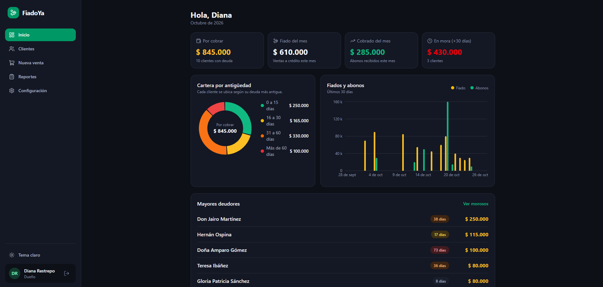
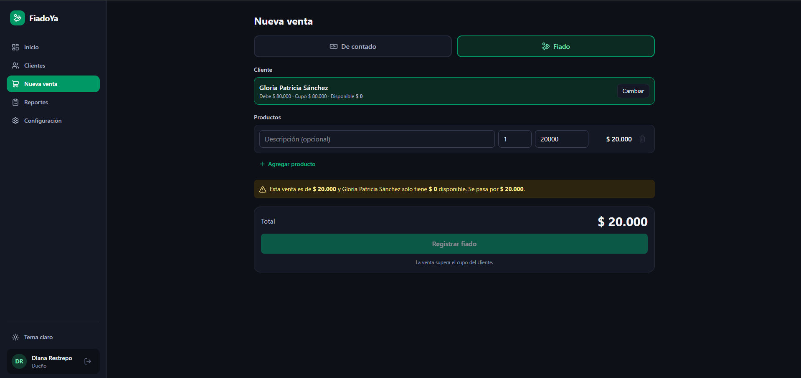
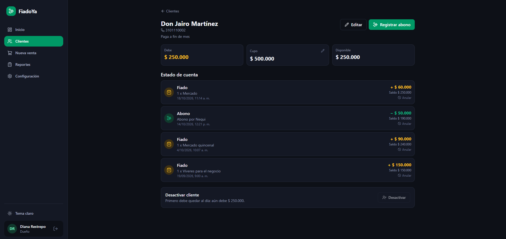
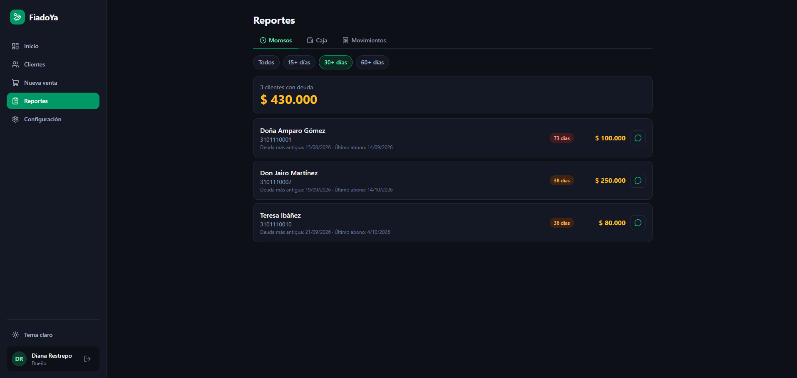
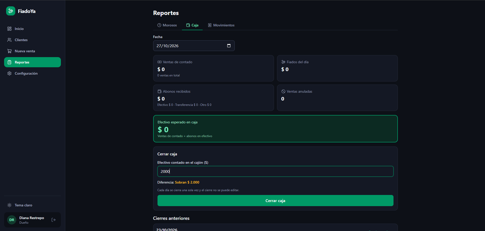
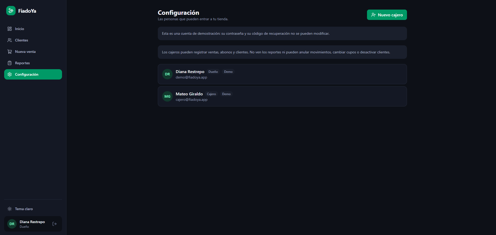
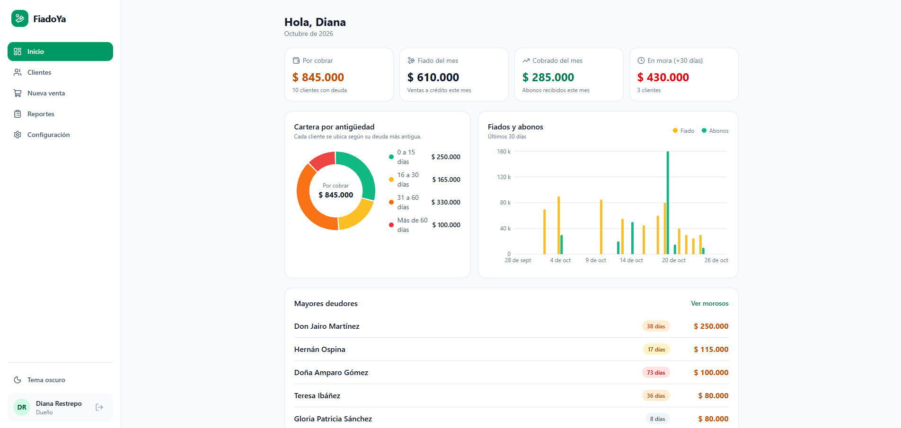
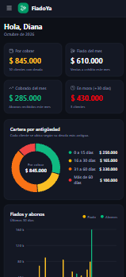
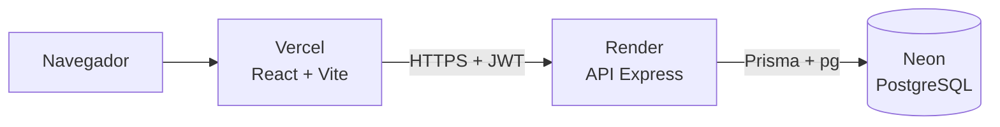
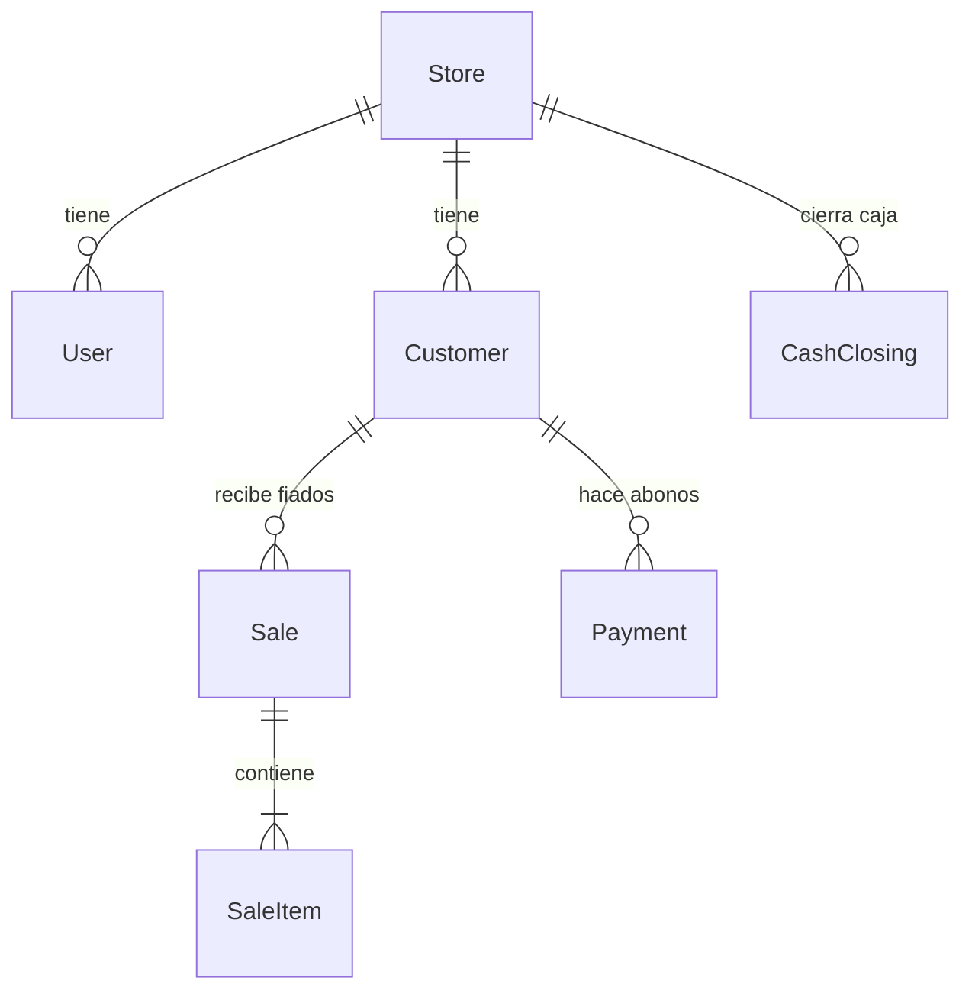

# FiadoYa

> Control de fiados, abonos y caja para tiendas de barrio.

[](https://github.com/Andresdev-coder/fiadoya/actions/workflows/ci.yml)

**[Ver la demostración en línea](https://fiadoya.vercel.app)**. En la pantalla de ingreso, usa los botones **Cuenta de dueño** o **Cuenta de cajero**.

> La API corre en el plan gratuito de Render: si nadie la usó en los últimos 15 minutos, la primera carga puede tardar hasta un minuto en despertar.

<p align="center">
  
</p>

## El problema

Muchas tiendas de barrio fían a sus clientes y llevan la cuenta en un cuaderno. Con el tiempo pasan siempre las mismas cosas: se olvidan abonos, a un cliente se le fía más de lo que debería, nadie sabe a ciencia cierta cuánto debe cada uno ni desde cuándo, y la caja no cuadra al final del día.

FiadoYa reemplaza el cuaderno por un sistema donde **el cupo de cada cliente se respeta siempre**, el saldo nunca se desincroniza, ningún movimiento se borra y el dueño ve de un vistazo quién le debe, cuánto y hace cuánto.

Es un proyecto de portafolio full stack, construido alrededor de ese problema.

<!-- Si hablas con un tendero real, agrega aquí una sección corta: cómo lleva hoy los fiados, qué le duele más y qué cambió con el sistema. Es lo que más diferencia un proyecto de portafolio. -->

## Qué incluye

| | Dueño | Cajero |
|---|:---:|:---:|
| Registrar ventas de contado y fiados | ✅ | ✅ |
| Registrar abonos | ✅ | ✅ |
| Crear y editar clientes (nombre, teléfono, notas) | ✅ | ✅ |
| Cerrar la caja del día | ✅ | ✅ |
| Definir y cambiar el cupo de fiado | ✅ | ❌ |
| Activar y desactivar clientes | ✅ | ❌ |
| Anular ventas y abonos (con motivo) | ✅ | ❌ |
| Panel de inicio, morosos, caja y movimientos | ✅ | ❌ |
| Gestionar cajeros y recuperar su propia cuenta | ✅ | ❌ |

Además: tema claro y oscuro, cobro por WhatsApp con el mensaje ya escrito, estado de cuenta por cliente con saldo acumulado y diseño adaptable a celular.

## Capturas

<table>
  <tr>
    <td width="50%">
      
      <br><sub><b>Nueva venta.</b> Si el fiado supera el cupo, el sistema avisa cuánto se pasa y no deja registrarlo.</sub>
    </td>
    <td width="50%">
      
      <br><sub><b>Estado de cuenta.</b> Línea de tiempo de fiados y abonos con el saldo después de cada movimiento.</sub>
    </td>
  </tr>
  <tr>
    <td width="50%">
      
      <br><sub><b>Morosos.</b> Clientes ordenados por antigüedad de la deuda, con filtro por días y cobro por WhatsApp.</sub>
    </td>
    <td width="50%">
      
      <br><sub><b>Cierre de caja.</b> El efectivo esperado contra lo contado, con la diferencia en vivo.</sub>
    </td>
  </tr>
  <tr>
    <td width="50%">
      
      <br><sub><b>Configuración.</b> El dueño crea cajeros, les cambia la contraseña y genera su código de recuperación.</sub>
    </td>
    <td width="50%">
      
      <br><sub><b>Tema claro.</b> El mismo panel con el tema claro.</sub>
    </td>
  </tr>
</table>

<p align="center">
  
</p>

## Cómo probar la demostración

Entra con **Cuenta de dueño** y prueba, en este orden:

1. **Nueva venta → Fiado** a *Gloria Patricia Sánchez*: ya tiene el cupo agotado, así que el sistema bloquea el fiado y explica por qué.
2. Abre a *Don Jairo Martínez* y **registra un abono**: el saldo y el estado de cuenta se actualizan al instante.
3. **Anula** un movimiento: queda tachado con su motivo y el saldo se corrige solo.
4. En **Reportes → Morosos**, filtra por *30+ días* y mira el botón de cobro por WhatsApp.
5. En **Reportes → Caja**, escribe un efectivo contado distinto del esperado y mira la diferencia.
6. Vuelve a la pantalla de ingreso y entra como **cajero**: no ve el inicio, los reportes ni la configuración.

Los datos de la demostración son ficticios y cualquier visitante puede modificarlos. Las cuentas de demostración tienen la contraseña y el código de recuperación protegidos.

## Stack

| Capa | Tecnología |
|---|---|
| Frontend | React, TypeScript, Vite, Tailwind CSS v4, React Router, TanStack Query, Recharts, lucide-react |
| Backend | Node.js, Express 5, TypeScript, Zod, JWT, bcrypt, helmet, express-rate-limit |
| Datos | PostgreSQL 16, Prisma 7 con `@prisma/adapter-pg` |
| Pruebas | Vitest, Supertest (pruebas de integración contra una base real) |
| CI/CD | GitHub Actions |
| Despliegue | Vercel (web), Render (API), Neon (base de datos) |

## Arquitectura



Una instalación puede atender a varias tiendas: cada tabla lleva el `storeId` y toda consulta lo filtra con el que viene en la sesión.



## Decisiones de diseño

| Decisión | Por qué | Cómo se comprueba |
|---|---|---|
| **Dinero en pesos enteros** (COP, sin decimales) | Evita los errores de redondeo con números flotantes. | Las validaciones rechazan montos decimales. |
| **El saldo se calcula, no se guarda**: fiados activos menos abonos activos | No puede desincronizarse, y anular un movimiento corrige el saldo solo. | Pruebas de ventas y abonos anulados. |
| **Bloqueo de fila** (`SELECT … FOR UPDATE`) al fiar, abonar y anular | Dos peticiones simultáneas no pueden saltarse el cupo ni dejar el saldo en negativo. | `concurrency.test.ts` lanza peticiones simultáneas y exige que solo una pase. |
| **Nada se borra, se anula** con motivo y fecha | Trazabilidad: el historial de cada cuenta siempre se puede auditar. | Pruebas de anulación en ventas y abonos. |
| **El total de cada venta lo calcula el servidor** | El cliente no puede mandar un total que no corresponde. | Prueba que ignora el total enviado. |
| **No se anula efectivo con la caja del día cerrada** | Un cierre ya contado no puede cambiar después. | Pruebas de guardia de caja cerrada. |
| **Fechas de negocio en hora de Colombia** | Una venta de las 8 p. m. no debe caer en el día siguiente. | Pruebas del resumen diario y del dashboard. |
| **Aislamiento por tienda** en cada consulta | Una tienda no ve ni toca los datos de otra. | Pruebas que cruzan identificadores entre tiendas. |
| **Mora por antigüedad (FIFO)**: los abonos cubren primero la deuda más vieja | Quien abonó hace un año y fió ayer no aparece como moroso. | Prueba del reporte de morosos. |

## Reglas de negocio

- Un fiado no puede dejar `saldo + total` por encima del cupo del cliente.
- Un abono no puede superar el saldo.
- Un fiado siempre tiene un cliente asociado.
- No se puede anular un fiado si el cliente ya abonó más de lo que quedaría debiendo.
- No se puede desactivar un cliente con deuda.
- Solo hay un cierre de caja por día.
- El efectivo esperado en caja es: ventas de contado más abonos en efectivo.

## Seguridad

- Sesión con JWT de 7 días, **verificada contra la base en cada petición**: un usuario desactivado pierde el acceso de inmediato.
- **Cambiar o recuperar la contraseña cierra las demás sesiones** abiertas de esa cuenta.
- Contraseñas con bcrypt. El código de recuperación del dueño se guarda solo como hash, sirve una sola vez y se consume con una condición atómica en la base.
- **Límite de intentos por cuenta** (5 fallos cada 15 minutos en el ingreso y en la recuperación), que no depende de la IP del visitante, y un tope global de registros.
- Validación de toda entrada con Zod, `helmet`, CORS limitado a un solo origen y errores siempre en JSON.
- Las cuentas de demostración tienen la contraseña protegida para que un visitante no pueda bloquear la demo.

## API

| Área | Rutas principales |
|---|---|
| Sesión | `POST /auth/register`, `/auth/login`, `GET /auth/me`, `POST /auth/change-password`, `/auth/recovery-code`, `/auth/recover` |
| Clientes | `GET/POST /customers`, `GET/PATCH /customers/:id`, `GET /customers/:id/statement` |
| Ventas | `POST/GET /sales`, `GET /sales/:id`, `POST /sales/:id/void` |
| Abonos | `POST/GET /payments`, `POST /payments/:id/void` |
| Reportes (dueño) | `GET /reports/overdue`, `/reports/daily-summary`, `/reports/dashboard` |
| Caja | `POST /cash-closings`, `GET /cash-closings` (dueño) |
| Equipo (dueño) | `GET/POST /users`, `PATCH /users/:id` |

## Pruebas y CI

Las pruebas son de integración: levantan la API real contra una base PostgreSQL de pruebas y cada una crea su propia tienda, así que no se estorban entre sí.

| Archivo | Qué cubre |
|---|---|
| `auth` | Registro, ingreso y errores uniformes |
| `customers` | Validaciones, permisos por rol, aislamiento entre tiendas, activar y desactivar |
| `sales` | Total calculado en el servidor, cupo, anulaciones y caja cerrada |
| `payments` | Abonos, saldo, estado de cuenta y anulaciones |
| `reports` | Resumen del día, cierre de caja, morosos y dashboard |
| `concurrency` | Fiados y abonos simultáneos |
| `users` | Gestión de cajeros |
| `account` | Cambio de contraseña, código de recuperación y cierre de sesiones |
| `security` | Cabeceras, errores en JSON y límites de intentos |

En cada push, GitHub Actions instala, genera el cliente de Prisma, aplica las migraciones a una base PostgreSQL de servicio, comprueba los tipos, compila y corre todas las pruebas; el frontend también se compila.

## Ejecutarlo en local

Requisitos: Node 24, pnpm 12 y Docker.

```bash
git clone https://github.com/Andresdev-coder/fiadoya.git
cd fiadoya

# Base de datos: PostgreSQL en el puerto 5433 (crea también fiadoya_test)
docker compose up -d

# API
cd api
cp .env.example .env
pnpm install
pnpm prisma generate
pnpm prisma migrate deploy
pnpm seed:demo        # tienda de ejemplo: demo@fiadoya.app y cajero@fiadoya.app (contraseña Demo12345)
pnpm dev              # http://localhost:3000

# Web, en otra terminal
cd web
pnpm install
pnpm dev              # http://localhost:5173
```

Crea `web/.env` con:

```
VITE_API_URL=http://localhost:3000
VITE_DEMO_MODE=true
```

Para correr las pruebas:

```bash
cd api
cp .env.test.example .env.test
pnpm test:db          # aplica las migraciones a fiadoya_test
pnpm test
```

### Variables de entorno

| Variable | Dónde | Descripción |
|---|---|---|
| `DATABASE_URL` | API | Cadena de conexión de PostgreSQL |
| `JWT_SECRET` | API | Clave para firmar sesiones, de al menos 32 caracteres |
| `PORT` | API | Puerto (3000 por defecto) |
| `CORS_ORIGIN` | API | Origen exacto del frontend, sin barra final |
| `DEMO_EMAILS` | API | Opcional: correos de cuentas de demostración protegidas, separados por coma |
| `RATE_LIMIT_OFF` | API | `true` solo en pruebas |
| `VITE_API_URL` | Web | URL de la API, sin barra final |
| `VITE_DEMO_MODE` | Web | `true` muestra los botones de la demostración en el ingreso |

## Despliegue

- **Neon:** un proyecto de PostgreSQL. Las migraciones se aplican con `pnpm db:deploy:prod` desde `api/`, usando un `.env.production` (ignorado por Git) con `DATABASE_URL` y `DIRECT_URL`.
- **Render:** servicio web con *Root Directory* `api`. Build: `pnpm install --frozen-lockfile --prod=false && pnpm prisma generate && pnpm build`. Start: `pnpm start`. Health check: `/health`. La API se empaqueta con esbuild.
- **Vercel:** *Root Directory* `web`, con `VITE_API_URL` y, para la demostración, `VITE_DEMO_MODE=true`. Un `vercel.json` reescribe todas las rutas hacia `index.html`.

Para restablecer los datos de la demostración: `pnpm seed:demo:prod` (borra y recrea solo esa tienda).

## Limitaciones conocidas

- **Sin correo electrónico:** el dueño recupera su cuenta con un código de un solo uso que genera en Configuración. El correo necesita un dominio propio, y los servicios web gratuitos de Render bloquean el tráfico SMTP.
- **Los límites de intentos viven en la memoria del servidor** y se reinician si Render lo duerme o reinicia. Con varias instancias habría que usar un almacén compartido.
- **No hay límite por IP:** no está documentado cuántos proxies hay delante de Render, y configurarlo mal permite falsificar la IP o hace que todos compartan un mismo contador. El límite por cuenta no tiene ese problema, pero no frena a quien prueba una sola contraseña contra muchos correos.
- **Un cierre de caja no congela el día:** una venta de contado registrada después de cerrar no cambia el cierre ya guardado.
- **No hay base de caja:** si el cajón abre con sencillo, la diferencia sale sobrante.
- **La cartera por antigüedad usa la deuda más vieja de cada cliente:** quien debe una suma pequeña muy antigua y una grande reciente cuenta completo en el tramo más viejo.
- **El resumen se calcula en cada visita:** para una tienda de barrio sobra, con miles de movimientos al mes habría que pasar a agregaciones en SQL.
- **Cambiar la contraseña de un cajero lo desconecta, pero los cajeros no pueden cambiarla ellos mismos:** se la cambia el dueño.

## Siguientes pasos

- Cobro automático con la API oficial de WhatsApp Business.
- Correo electrónico como segunda vía de recuperación, con un dominio propio.
- Límites por IP, una vez medida la topología de proxies, y Redis para compartir los contadores.
- Efectivo inicial de caja y cierre ciego para el cajero.
- Catálogo de productos con precios guardados e inventario.
- Exportar reportes a PDF y Excel.

## Estructura del repositorio

```
fiadoya/
├── api/                  API REST
│   ├── prisma/           esquema y migraciones
│   ├── scripts/          datos de demostración y limpieza
│   ├── src/
│   │   ├── modules/      auth, customers, sales, payments, reports, users
│   │   ├── middlewares/  autenticación, límites, errores
│   │   └── utils/
│   └── tests/            pruebas de integración
├── web/                  aplicación React
│   └── src/              api, components, hooks, lib, pages
├── docker/               inicialización de PostgreSQL
├── docker-compose.yml
└── .github/workflows/    integración continua
```

## Autor

Hecho por [@Andresdev-coder](https://github.com/Andresdev-coder).

<!-- Agrega aquí tu nombre completo y tu LinkedIn o correo de contacto. -->
